<div align="center">

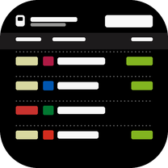

# GO Stations

**GO Transit's departure boards, every train live on the map, and your train on the Lock Screen.**<br>
A native iOS app for people who ride GO trains, with a small serverless backend.

[](https://github.com/RobOHt/go-stations/actions/workflows/testflight.yml)
[](https://github.com/RobOHt/go-stations/actions/workflows/worker.yml)
[](https://github.com/RobOHt/go-stations/actions/workflows/commute.yml)
<br>


[](LICENSE)

<p>
  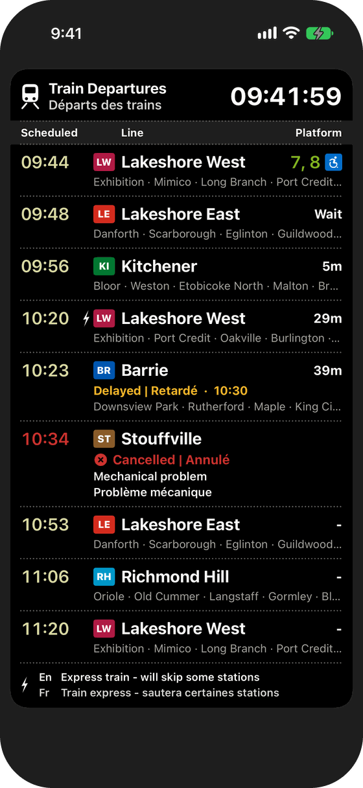
  &nbsp;
  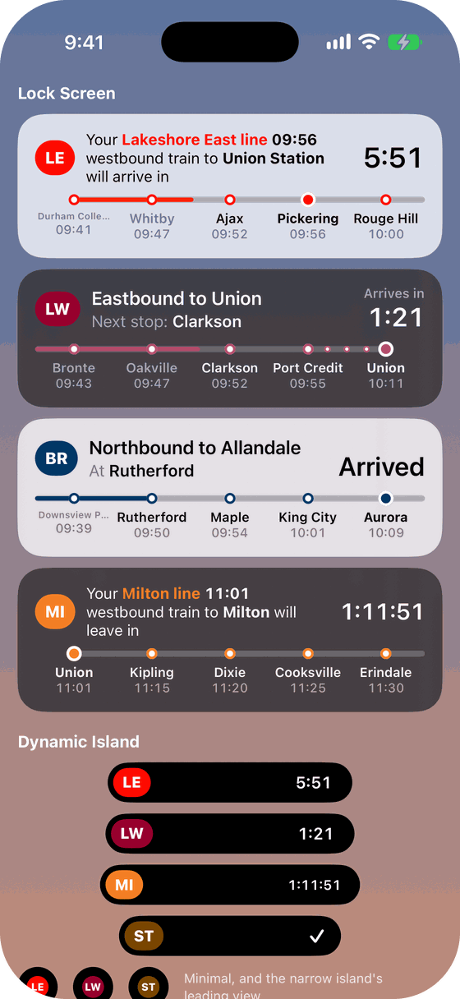
  &nbsp;
  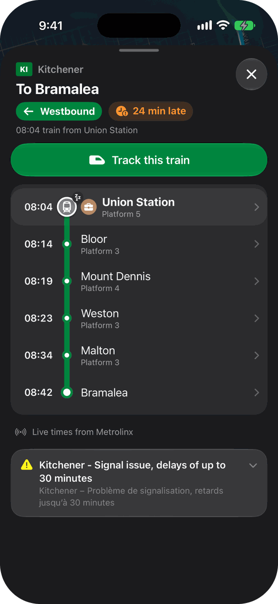
</p>

</div>

## What it does

- **The board, as it looks in the station.** Tap a station for its departure screen in your pocket: GO's bilingual title, line colours, platforms with ♿, the ⚡ express marker, delays, red cancellations, and Union's countdown to each train's platform ("29m").
- **Every train, live.** The map draws every GO train running now, moving along its real track from GO's GPS feed, and fading out a minute after its last stop. Tap one for its stops, how late it is, and how fast it's going.
- **Track a train, even with the app closed.** A Live Activity on the Lock Screen and in the Dynamic Island counts down to your train, then to your stop, updated by push as the train pulls in and leaves each station. Alerts come 5 minutes before you change trains or get off.
- **Plan a trip anywhere.** Search a station or any place Apple Maps knows: the card offers the trip you'd make right now, changes and all, starting from the station that gets you there soonest, and the rest of the day's trips.
- **Opens to the right board.** With home and work set, launch opens the board you most likely want (at home, on your commute, near work), worked out on the phone from the timetable, so it's instant.
- **Honest when GO's data isn't.** Cancellations come from two GO feeds read together; when live data is down or frozen, the app falls back to the timetable and says so.

The full tour, screen by screen: [docs/FEATURES.md](docs/FEATURES.md).

## See it in action

<table>
  <tr>
    <td align="center" width="33%">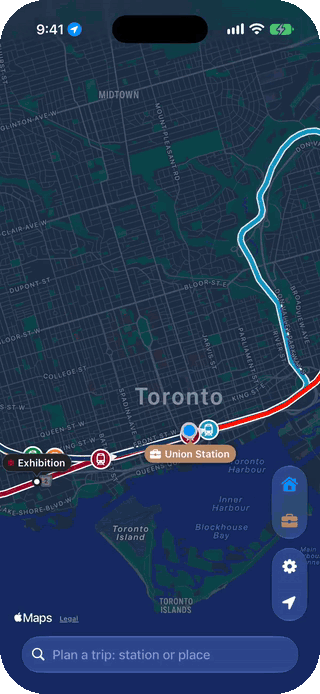<br><b>Every train, live</b></td>
    <td align="center" width="33%">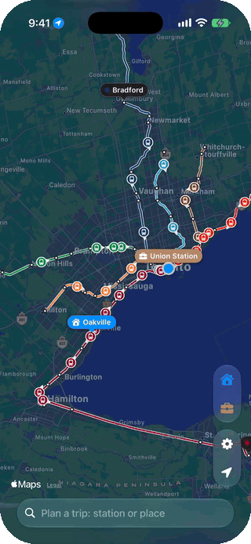<br><b>Map, board, a train's stops</b></td>
    <td align="center" width="33%">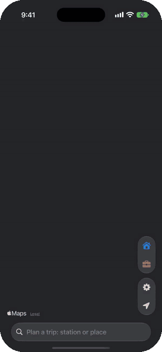<br><b>A trip planned from search</b></td>
  </tr>
  <tr>
    <td align="center">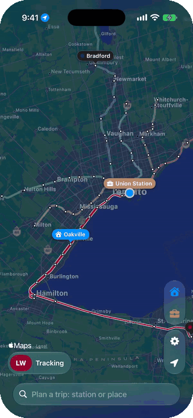<br><b>A tracked train, followed</b></td>
    <td align="center">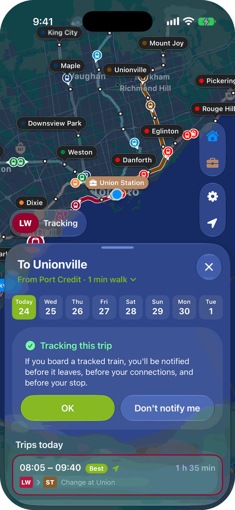<br><b>A whole trip, tracked</b></td>
    <td align="center">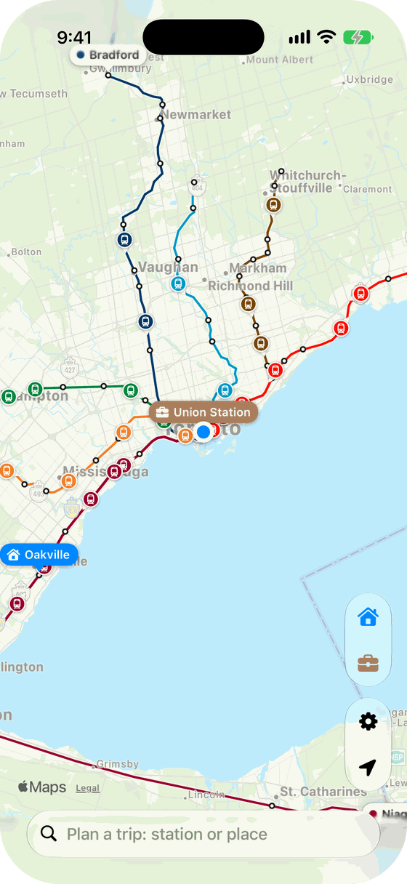<br><b>Light or dark</b></td>
  </tr>
</table>

<sub>Recorded at a weekday rush hour in the iOS simulator by the <a href=".github/workflows/readme-media.yml">README media workflow</a>, from GO's live data, with the made-up commuter the tests use (home Oakville, work Union) and, in the screenshots at the top, a made-up delay, cancellation and alert. Full quality: <a href="docs/media/union-trains.mp4">every train</a> · <a href="docs/media/trip.mp4">board and stops</a> · <a href="docs/media/plan.mp4">trip planning</a> · <a href="docs/media/tracked.mp4">tracking</a>.</sub>

## How it's built

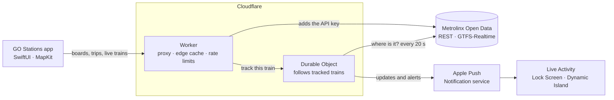

The app does the planning and drawing on the phone. A Cloudflare Worker sits between it and Metrolinx: it holds the API key, caches answers at the edge so riders share requests, merges GO's position and delay feeds, and follows each tracked train to push its Live Activity. More in [docs/ARCHITECTURE.md](docs/ARCHITECTURE.md).

### Engineering highlights

- **Live Activities that keep up with the app closed.** A Durable Object looks at each tracked train every 20 seconds, notes when it pulls in at a stop and leaves it, re-times the stops ahead from how late it's running, and pushes the Live Activity through APNs only when something changed, with an alert when you're 5 minutes from your change or stop. On a trip with changes, the next train takes over in the same Live Activity.
- **Built for unreliable data.** Transit feeds freeze for days, answer with web pages, and change shape. Tests written from a rider's point of view, before reading the code, plus thousands of rounds of seeded random junk, turned up 38 failures in the existing code; all are fixed. One odd value no longer throws away a whole answer, and one broken trip can't hold up every rider's Live Activity.
- **Trains that move like trains.** GO reports positions every ~20 seconds, 5 to 15 seconds late. The map draws each train 5 seconds behind now along the real track geometry, through its reported positions, braking for stations, so it never jumps or goes backwards.
- **Checked against an independent model.** The start-up planner is written twice, in Swift for the app and in Python as a reference; CI compares them on thousands of random situations on the real timetable, daylight saving changes included.
- **No secrets in the app, no third-party dependencies.** Keys live only in Worker and CI secrets. The app uses Apple's frameworks only, and the Worker only Cloudflare's runtime and Node's built-in test runner.
- **Every push ships, once it's proven.** A push to `main` runs 49 app tests on a simulator (unit tests, UI tests driven with made-up feeds, an accessibility audit), and only then archives and uploads to TestFlight. The Worker deploys after its 72 tests pass.

### Tech stack

| Layer | Built with |
| --- | --- |
| **App** | Swift, SwiftUI, MapKit, ActivityKit and WidgetKit (Live Activity, Dynamic Island), Core Location, iCloud key-value storage |
| **Backend** | Cloudflare Workers, Durable Objects with alarms, edge caching, rate limiting, APNs with token auth |
| **Data** | Metrolinx Open Data API, GO GTFS and GTFS-Realtime (vehicle positions, trip updates) |
| **Testing** | Swift Testing, XCTest and XCUITest, Node's test runner, a Python reference model |
| **Delivery** | GitHub Actions, App Store Connect API, TestFlight |

## Getting started

```sh
git clone https://github.com/RobOHt/go-stations.git
cd go-stations
open Departures.xcodeproj    # Xcode 26 or later: pick your team, then Run
```

The app works out of the box against the project's Worker. To run your own Worker, Live Activity pushes and TestFlight builds, see [docs/SETUP.md](docs/SETUP.md).

### Running the tests

```sh
node --test worker/test/*.test.js    # the Worker: 72 tests, a few seconds, no network
```

In Xcode, **Product → Test** runs the app's 49 unit and UI tests. Most of them are about what a rider should see when GO's data is wrong: a feed down or frozen, a web page instead of data, numbers where there's usually text, one train where there's usually a list, trains twice or out of order, impossible positions.

## Repository layout

```
Departures/            the iOS app (the Xcode target is named Departures)
  API/                 Metrolinx client, boards, live trains, cancellations, timetable
  Board/               the departure board
  Planner/             which board to open on launch; trips planned from search
  Tracking/            the tracked train or trip, its alerts and Live Activity
  Views/               map, search, trip card, station sheet, settings
  Model/  App/  Settings/  Location/  Resources/
DeparturesWidgets/     widget extension that draws the Live Activity
DeparturesTests/       unit tests (GO's feeds played by FakeNetwork)
DeparturesUITests/     UI tests (made-up feeds the app serves itself)
worker/                the Cloudflare Worker and its tests
tools/                 GTFS → network and timetable; the planner's Python reference
docs/                  features, architecture, setup, README media
```

## Contributing

Contributions are welcome. Please read [CONTRIBUTING.md](CONTRIBUTING.md) first; in short:

- **Open an issue first**, and for anything that changes how the app looks or behaves, agree on the design before writing the code.
- **No personal data and no keys**, anywhere: use the made-up commuter from the tests (home Oakville, work Union) in code, tests and screenshots.
- **Expect GO's data to be wrong**: for anything that reads it, write the test first, from what a rider should see.
- **`main` is always releasable**: every merge runs the tests and ships a TestFlight build.

Report security problems privately, as [SECURITY.md](SECURITY.md) describes. Everyone taking part follows the [code of conduct](CODE_OF_CONDUCT.md).

## License

The code is released under the [MIT License](LICENSE).

Contains information licensed under the [Open Government Licence – Ontario](https://www.ontario.ca/page/open-government-licence-ontario) (Metrolinx GTFS and Open Data API). GO Stations is an independent project, not affiliated with or endorsed by Metrolinx or GO Transit.

---

<div align="center">

Built by [Robin Zhong](https://github.com/RobOHt)

</div>
