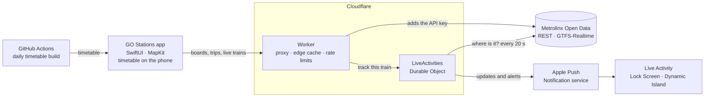
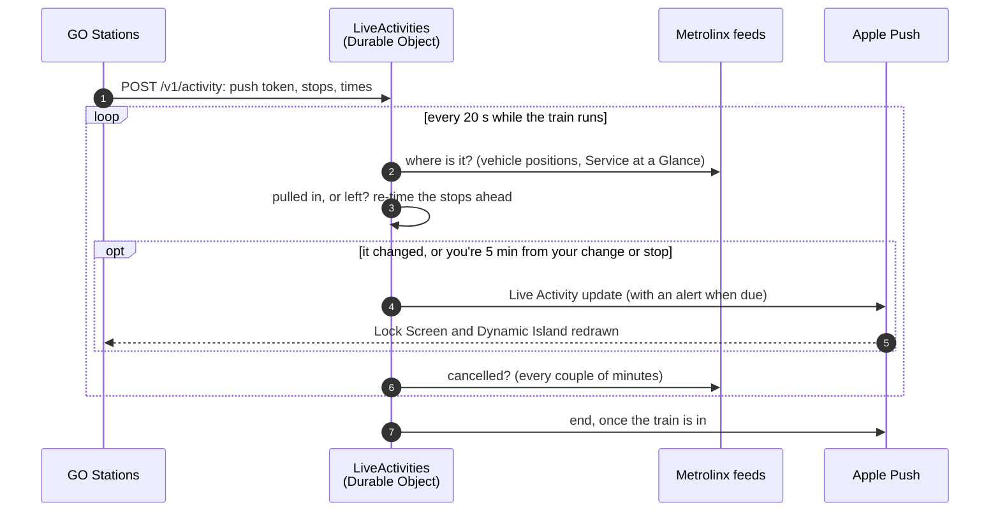

# Architecture

GO Stations is a native iOS app with a small serverless backend. The app does all
the planning and drawing on the phone; a Cloudflare Worker sits between it and
Metrolinx's feeds (holding the API key, caching, merging feeds), and follows
tracked trains to push their Live Activities while the app is closed.



## The app

| Folder | What's in it |
| --- | --- |
| `Departures/App` | Entry point; debug scenes for screenshots and recordings; the in-app self-checks |
| `Departures/API` | The Metrolinx client and response shapes (read leniently), board assembly, live trains, cancellations, the timetable store |
| `Departures/Board` | The departure board: view, theme, refresh model |
| `Departures/Model` | The bundled rail network (lines, track shapes, stations), board rows, Toronto time helpers |
| `Departures/Planner` | Which board to open on launch, and trips planned from search |
| `Departures/Tracking` | The tracked train or trip: its button, alerts, missed-train check, and its Live Activity (views shared with the widget extension) |
| `Departures/Views` | Map, search, trip card, station sheet, settings |
| `DeparturesWidgets` | The widget extension that draws the Live Activity |

There are no third-party dependencies: the app uses Apple's frameworks only
(SwiftUI, MapKit, ActivityKit, WidgetKit, Core Location), and the Worker only
Cloudflare's runtime.

## Where the data comes from

| What | Where it comes from |
| --- | --- |
| Lines, colours, track shapes, stations | `Departures/Resources/network.json`, generated from the official GO GTFS feed (`tools/build_network.py`) |
| Live data | The Worker in `worker/`, which forwards to Metrolinx Open Data with the key and caches answers for 20 s to 10 min |
| Live train positions | GO's GTFS vehicle positions (every ~20 s: where each train is, and whether it's standing at a station) with Service at a Glance's delays, merged by the Worker (`/v1/live/trains`, cached 5 s) |
| Union Station board | `ServiceUpdate/UnionDepartures/All` (platforms, "Express To" stop lists) |
| Other stations | `Stop/NextService/{station}` plus `Schedule/Trip/{date}/{trip}` for the stop list (cached per day) |
| Delays | `ComputedDepartureTime` vs `ScheduledDepartureTime` from NextService |
| Cancellations | GO's GTFS trip updates (trips cancelled, stations skipped) and `ServiceUpdate/Exceptions/Train`, read together by the Worker (`/v1/live/cancelled`, cached 30 s), since either has had a cancellation the other hadn't; a station's own board too. Reasons from `ServiceUpdate/ServiceAlert/All` |
| Alerts under a board | `ServiceUpdate/ServiceAlert/All`, filtered to the station's lines |
| When live data is unavailable | `schedule.json`: the next 14 days of trains from GO's GTFS, rebuilt daily on the `schedule-data` branch (`tools/build_schedule.py`), bundled into each build and downloaded by the app |

The board refreshes every 20 seconds while it's open (matching the Worker's cache)
and right away when you come back to the app. Live train positions refresh every 5
seconds while the map shows the tracked train or all trains (every 15 seconds while
a train's stops are open). Nothing is fetched in the background, apart from one
check a while after a tracked train is due at your stop, to end its Live Activity.
Metrolinx has no push feed, so polling is as fresh as it gets.

Express trips are detected from the trip's stop list: if it skips two or more
stations in a row that the line's all-stops pattern serves, it gets the ⚡. At Union
the feed marks them directly.

## A train is only ever where its GPS says

One rule decides where a train is drawn: the GPS position GO reports for it is the
only thing taken as true. GO reports each train about every 15 seconds, and a report
is 5 to 25 seconds old by the time the app has it. The map draws each train where
its latest report has it, at the nearest point of its line's track (or just where
the report says, when that's well off the line: a yard, a detour), and moves it
there in one quick slide as soon as a new report is in. Nothing else places a train:
not the timetable, not where it would be by now if it kept going, not the station's
own spot when GO says it's standing there. A train with no report in the last two
minutes isn't drawn.

Your phone's GPS never places a train, not even the one you're on: you're your own
blue dot, and the train is where GO last had it (so riding it, your dot runs a
little ahead of it, by however old its latest report is). Its pointer shows the way
its track runs there, and its speed is what it covered between its last two reports:
measured, or not shown.

Earlier versions drew trains smoothly, a few seconds behind, guessing ahead of the
latest report and easing between guesses, and drew the tracked train where you were
once you were on it. That looked better and was sometimes wrong: a train standing at
a platform drawn still coming in, its speed and pointer swinging about under a
station's roof with the phone's GPS. Being right matters more.

## The Worker

One Worker (`worker/src/index.js`, `worker/src/live.js`), no dependencies:

| Endpoint | What it does |
| --- | --- |
| `GET /v1/{Metrolinx path}` | Forwards the five read-only Metrolinx endpoints the app uses, with the key. Only GO's data goes back, never its error pages; good answers are cached at the edge for 20 s to 10 min |
| `GET /v1/live/trains` | Every train running now: GTFS vehicle positions merged with Service at a Glance (delays, motion, heading), cached 5 s |
| `GET /v1/live/cancelled` | Cancelled trains and skipped stations from GO's two cancellation feeds together, cached 30 s |
| `POST /v1/activity` | Starts following a tracked trip for its Live Activity (and `/v1/activity/end` stops) |

Requests that reach Metrolinx are rate-limited per IP. The Metrolinx and Apple push
keys are Worker secrets; nothing secret ships in the app.

## Following a tracked train

The `LiveActivities` Durable Object keeps each tracked trip (its push token, stops
and times) until the trip ends, and wakes on an alarm:



- **Arrivals and departures** come from the train's own reports: "Arrived" shows
  from when it's seen pulling in to when it's seen leaving; a report older than the
  last one looked at, or from a yard, doesn't move it.
- **On a trip with changes**, once the train you're on gets in where you change,
  the next train takes over in the same Live Activity.
- **Cancelled** (or not stopping where you get on or off), the Live Activity says
  so, with an alert, and the app is woken to find the next train.
- **Missed it?** A couple of minutes after your first train leaves, a silent push
  wakes the app to check you're on it (it knows where you are; the Worker doesn't).
- **One trip the Worker can't handle** is skipped and, after failing a few times,
  dropped, so it never holds up everyone else's.

## Built for unreliable data

Transit feeds freeze for days, answer with web pages, and say the same thing in
different shapes. The app and the Worker are tested against that, with tests written
from what a rider should see before looking at how the code handles it:

- **The Worker** (`worker/test/robustness.test.js`): GO failing in every way a proxy
  can see, frozen feeds, trains listed twice or out of order, impossible positions,
  the clock change; then thousands of seeded rounds of random junk, checking that
  every train, cancellation and push is one the app can read and show.
- **The app** (`DeparturesTests`): boards, a train's stops, live positions,
  cancellations and alerts through a stand-in for the network (`FakeNetwork`).
  Every field of GO's answers is read leniently, so one odd value costs that value,
  not the whole answer; junk in place of the answer itself falls back to the
  timetable, saying so.
- **The UI** (`DeparturesUITests`): the app driven like a rider, with made-up feeds
  the app serves itself in debug builds (`GOFixtures`), and an accessibility audit.

## Continuous delivery

| Workflow | When | What it does |
| --- | --- | --- |
| TestFlight | Every push to `main` that touches the app | Runs the app's unit and UI tests on a simulator; only if they pass, archives and uploads to TestFlight (build number = run number + 10) |
| Worker | Changes under `worker/` | Runs the Worker's tests, then deploys it |
| Tests | Pull requests, other branches | The app's unit and UI tests |
| Build | Pull requests | Compiles the app for the simulator, listing every warning |
| Commute check | Changes to the planner | The start-up planner against its Python reference (`tools/commute_reference.py`) on the current timetable: thousands of random situations must give the same station for the same reason |
| Timetable | Daily | Rebuilds `schedule.json` from GO's GTFS on the `schedule-data` branch |
| Screenshots | `preview/**` branches, or by hand | Simulator screenshots of set-up scenes, for review by eye |
| README media | By hand | Records the README's clips and screenshots (`tools/readme_media.py` makes `docs/media` from them, and `tools/demo_video.py` a short demo video) |

## Updating the network data

GTFS changes every few weeks, but tracks and stations rarely do. When a line or
station changes:

```sh
python3 tools/build_network.py            # downloads the official GO-GTFS.zip
# or
python3 tools/build_network.py --input path/to/GO-GTFS.zip
```
